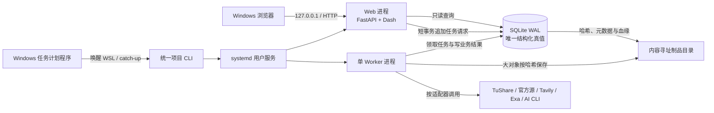

# WSL2 单机技术架构

> 决策日期：2026-08-21  
> 适用范围：Pring 周期驾驶舱 V1  
> 状态：已冻结的实施边界；视觉设计与刷新编排由后续决策补充；备份与保留由[《本机无备份与主存储保留策略》](local-no-backup-and-retention-policy.md)修正

## 1. 架构结论

V1 是运行在 WSL2 中的单用户本地应用。它只有一个权威 SQLite 数据库、一个内容寻址制品目录、一个 FastAPI + Plotly Dash Web 进程和一个独立 Worker 进程。Windows 浏览器只访问 `127.0.0.1`；不引入 Redis、Celery、WebSocket、Node.js、Docker、Sites、登录或公网部署。



## 2. 不可跨越的边界

1. SQLite 是证据、任务、阶段、报告快照和只读投影元数据的唯一结构化真值。
2. 原始网页、搜索响应、下载文件和 AI 正文等大对象进入本地内容寻址目录；SQLite 保存哈希、媒体类型、大小、来源和血缘。文件目录不是第二套可独立解释的数据库。
3. Worker 是业务数据的唯一常规写入者。Web 只允许查询只读投影，或用短事务和幂等键追加任务请求。
4. Dash 回调不得采集数据、运行阶段分类、调用 Codex/Claude CLI 或执行其他长任务。
5. 核心分类模块不依赖网络、Web 框架或数据库会话，可由固定输入在进程内确定性测试。
6. 缺少外部凭据时应用仍须启动：相关适配器显示为禁用，历史页面和离线模型可用；缺少 P0 核心证据时不产生新的正式阶段。

## 3. 运行时与代码组织

### 3.1 版本基线

- Python 3.12。
- 使用 `uv` 管理 Python、虚拟环境与依赖，提交 `uv.lock`，部署和升级均使用锁定依赖。
- Dash 与 FastAPI 的精确版本在首次实现时写入锁文件；升级必须走显式升级流程。
- V1 不需要 Node.js 构建链。

### 3.2 单仓库深模块

建议实现结构如下；等价命名可以调整，但依赖方向不可反转：

```text
src/pring_cycle/
  evidence/        # 来源声明、观测、vintage、as-of查询
  trends/          # 三资产趋势与候选状态
  cycle/           # 严格Stage I-VI映射
  macro/           # 政策、库存、通胀和特征卡
  reports/         # 证据包、AI报告、不可变快照
  retrieval/       # 数据源适配器与检索降级链
  projections/     # Web/Markdown只读投影
  jobs/            # 持久任务账本、领取和恢复接缝
apps/
  web/             # FastAPI、/api/v1、Dash页面
  worker/          # 单Worker循环
contracts/         # 版本化API与投影契约
tests/
```

`apps/web` 和 `apps/worker` 只能调用应用/领域接口，不能在入口层复制阶段规则或证据选择逻辑。

## 4. 持久化

### 4.1 SQLite WAL

- 使用 SQLAlchemy 2 访问 SQLite，使用 Alembic 执行显式模式迁移。
- 启用 WAL、外键约束和合理的 busy timeout；事务保持短小。
- Pydantic 只负责外部输入、API和投影边界校验，不作为持久化模型。
- 单 Worker 领取并完成业务任务；Web 的唯一写路径是幂等追加任务请求，因此不需要分布式锁或消息中间件。
- 任务、证据和报告失败必须保留可诊断状态，不能以覆盖或删除记录模拟回滚。

### 4.2 内容寻址制品

- 文件以内容哈希寻址，写入采用临时文件、校验哈希后原子改名。
- 数据库记录制品哈希、字节数、媒体类型、创建时间、来源/任务标识和引用关系。
- 报告正文的30天保留语义沿用领域决定；结构化报告清单、证据血缘和规则版本长期保留。
- V1不为SQLite、制品、报告或密钥建立第二份副本，也不创建升级前快照；GitHub只管理源码和静态定义。主存储的7/14/30天保留、容量上限和20/10/5GiB降级按[无备份与保留策略](local-no-backup-and-retention-policy.md)执行。

## 5. 任务与进程

### 5.1 两个常驻进程

| 进程 | 职责 | 禁止事项 |
| --- | --- | --- |
| `pring-web` | FastAPI REST、Dash页面、只读投影查询、短任务请求、健康与状态页面 | 不采集、不分类、不跑AI、不持有长写事务 |
| `pring-worker` | 领取持久任务、获取和校验证据、生成投影、运行AI CLI、记录结果和恢复信息 | 不维护浏览器会话或第二套任务真值 |

两个进程由 systemd 用户服务监督：`pring-web.service` 与 `pring-worker.service`。启用 user lingering，使 WSL 被唤醒后不依赖交互式登录维持服务。服务必须调用与人工操作相同的项目 CLI 入口，避免脚本和服务产生两套启动语义。

### 5.2 持久任务账本

任务至少拥有：任务ID、任务类型、规范化参数或参数制品引用、幂等键、计划时间、优先级、状态、尝试次数、领取/心跳/完成时间、错误分类和关联运行ID。

Web 或调度入口只能追加任务。Worker 通过短事务原子领取任务；进程退出后，过期领取可以恢复。确切互斥键、重试、报告日限额和部分成功规则由后续刷新编排决策冻结。

### 5.3 调度与唤醒

- Windows 任务计划程序只负责按计划唤醒指定 WSL 发行版并调用项目 `catch-up` 入口。
- 应用根据持久账本判断哪些计划已经完成，错过运行时在下次唤醒补排；Windows 任务本身不保存业务完成状态。
- 不使用 APScheduler、cron 脚本流水线或 Web 进程内定时器作为业务调度真值。

## 6. Web 与页面交付

### 6.1 同一 ASGI 服务

- FastAPI 和 Dash 4.2 使用 Dash 原生 FastAPI 后端，共享一个进程和端口。
- REST 路径使用版本前缀 `/api/v1`；Dash 页面占用独立页面路由，二者消费同一应用层只读投影。
- 只监听 `127.0.0.1`，不开放局域网、反向代理、公网隧道或 Sites 同步。
- 无项目级登录；写入任务命令仍须校验 Host/Origin、限制请求体、使用幂等键，避免任意网页向 localhost 静默提交工作。

### 6.2 页面状态更新

不使用 WebSocket、Redis Pub/Sub、Redis Streams或通知 Outbox。页面以 SQLite 中的最新完整投影为真值，并采用：

- 首次打开立即读取；
- 有活动任务时 `dcc.Interval` 默认每30秒刷新任务/投影状态；
- 无活动任务时默认每5分钟刷新，或在页面不可见/无需更新时暂停；
- 提供手动刷新；
- 轮询失败只显示连接状态，不清空上一完整投影。

轮询间隔是页面默认值，不是业务调度或数据新鲜度定义。

### 6.3 内容安全与视觉边界

- AI Markdown 以安全 Markdown 渲染，禁用原始 HTML、脚本和任意嵌入；链接只使用已经校验并随证据保存的来源URL。
- CSS、字体、图标和前端包固定版本并本地提供，断网时历史驾驶舱仍可使用；不依赖运行时 CDN。
- 页面视觉、布局和交互原型待本 Wayfinder 全部结束后使用 Open Design 单独开展；本票只冻结技术接缝。
- 浏览器不得重新计算趋势、正式阶段或宏观角色。

## 7. 配置、密钥与目录

运行状态必须位于 WSL 原生文件系统，不把 SQLite WAL、制品或日志放在 `/mnt/d`。遵循 XDG 目录：

| 类型 | 默认位置 | 内容 |
| --- | --- | --- |
| 配置 | `${XDG_CONFIG_HOME:-$HOME/.config}/pring-cycle/` | `config.toml`、权限为`0600`的`secrets.env` |
| 数据 | `${XDG_DATA_HOME:-$HOME/.local/share}/pring-cycle/` | SQLite、制品目录、迁移/版本元数据 |
| 状态 | `${XDG_STATE_HOME:-$HOME/.local/state}/pring-cycle/` | 轮转JSONL日志、运行状态 |
| 缓存 | `${XDG_CACHE_HOME:-$HOME/.cache}/pring-cycle/` | 可安全重建的临时缓存 |

源码可以继续位于 `/mnt/d/cursor/datasourcerf`，但仓库不保存运行数据库、制品、密钥或可变日志。

一次性密钥迁移命令只读旧项目 `/mnt/d/cursor/datasource/.env`，只允许导入 `TUSHARE_TOKEN`、`TAVILY_API_KEY` 和 `EXA_API_KEY`。它必须在内存解析、原子写入目标文件、设置`0600`且绝不回显值；新项目随后不依赖旧文件。Codex CLI 和 Claude Code CLI 继续使用各自认证存储。

## 8. CLI、升级与日志

统一 CLI 至少提供：

```text
pring-cycle init
pring-cycle doctor
pring-cycle start|stop|status
pring-cycle migrate
pring-cycle catch-up
pring-cycle import-legacy-secrets
```

- systemd 与人工运行调用同一 CLI/应用工厂。
- 升级是人工显式操作：只从干净、已提交的GitHub代码版本开始，先停止写入或进入维护状态并执行依赖、配置、磁盘和Schema预检，再执行Alembic前向迁移及健康检查；不创建SQLite或制品备份。
- 升级失败时进入`reinitialize_required`。可以修复前向迁移，或接受本机历史全部丢失并空库重建；Git回退和Alembic downgrade都不构成数据库恢复保证。
- `doctor`和升级预检必须明确显示`backup_mode=none`、RPO/RTO不保证以及本机历史可能全部丢失。
- 应用日志写入本地轮转 JSONL，至少包含时间、级别、组件、`run_id`、`job_id`和稳定错误码；密钥、请求认证头、原始AI提示上下文和完整外部响应不得进入日志。
- 证据、任务、版本和报告血缘属于SQLite审计记录，不用普通日志替代。

## 9. 实施验收门

架构实现至少通过以下验收：

1. 断网且三个项目凭据均缺失时，Web与Worker仍启动，历史页面可读，系统明确显示禁用适配器且不产生新正式阶段。
2. Web提交一个带幂等键的任务两次，账本只形成一个有效任务；Worker重启后可以恢复未完成任务。
3. Worker运行模拟长任务时，Dash与`/api/v1`仍响应；页面通过轮询看到状态变化而无WebSocket或Redis进程。
4. SQLite、WAL、制品、密钥和日志均位于WSL XDG目录，仓库和`/mnt/d`没有运行时写入。
5. 大制品写入中断不会留下数据库指向的半文件；哈希不匹配时拒绝登记。
6. `127.0.0.1`以外地址不能连接；不受信Origin不能追加任务。
7. 安全Markdown测试证明原始HTML、脚本、危险URL与事件属性不会执行。
8. 升级失败演练进入`reinitialize_required`，不声称存在恢复点；从GitHub重新检出只能初始化空系统，不能冒充恢复已丢失的历史快照。
9. 核心趋势与Stage I–VI映射测试不启动Web、SQLite或网络。

## 10. 明确不采用

- Redis、Celery、Dash后台回调、WebSocket和通知Outbox；
- Flask/WSGI桥接、第二个Web服务、Node.js前端构建链；
- Docker、Codex Sites、D1、远程同步、登录和公网服务；
- 把SQLite WAL或制品目录放到Windows挂载盘；
- 在Dash回调、模板或浏览器中复制正式阶段规则；
- 自动联网升级，或依赖数据库降级脚本作为回滚办法；
- 日常、升级前、Windows侧、外置盘、云端或异地运行数据备份。
