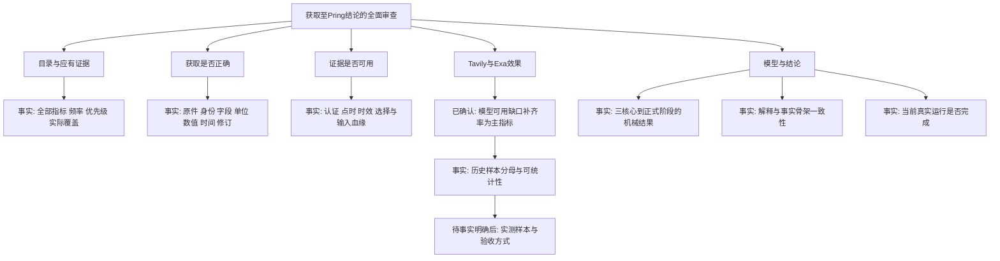

# 数据获取至Pring结论：审查与访谈

日期：2026-09-06。代码基线：`6edf0cb`。本轮按用户指定的 `grill-with-docs` 执行 `grilling` 与 `domain-modeling`。环境未提供独立的Skill调用工具，因此直接读取两个技能文件并依其规则执行。

## 用户目标与已确认边界

全面审查本项目的数据获取正确性、数据可用性、特别是Tavily／Exa命中率，以及证据能否正确进入Pring模型并生成结论。范围包括整个目录与实际运行记录，不能只看前轮五个市场family或测试通过数。

保持既有领域约定：正式阶段仅由股、债、商品三个核心价格状态决定，宏观及其他证据承担解释、观察或确认角色；公开点时与系统点时分别审查。当前旧投影可读，不代表最新数据已形成新结论。

本轮先进行只读事实审查、形成审查文件及明确口径。没有触发新数据抓取、付费搜索、正式Worker、模型变更或切换。数据获取修复及真实对照试验属于后续需要根据审查事实明确的工作。

## 决策树

## 第一轮：命中率口径

Q1：Tavily／Exa命中率采用“模型可用的缺口补齐率”为主，还是“相关原文命中率”为主？推荐前者，并同时报告请求成功、相关原文、字段校验等转化环节。

用户回复：**确认**。该回复采纳推荐主口径；没有因此改变既有认证、点时、来源或阶段规则，也不是对新搜索调用或模型切换的确认。对应两个领域术语已同步写入根 `CONTEXT.md`。

## 第二轮：结论的验收维度

Q2：是否将“输出结论正确”分成两个独立验收项：①Pring阶段及指标计算正确；②报告解释有完整证据支持？推荐分别验收，阶段通过不意味着AI解释通过，也不改变现有 `completed_degraded` 的运行语义。

状态：已通过异步问题提交，尚未收到回答。此前“确认”是Q1的回复，不延伸为Q2已确认。

## 事实审查结果与当前边界

三个代理分别完成全目录覆盖、Tavily／Exa实际记录、模型到结论链路的只读调查；根代理交叉核对并汇总为[审查报告](audit.md)。详细附件和精确SQL均保存在本目录。

- 全目录61项、272949条来源声明的结构检查未发现所覆盖的异常；官方原件与大量规范化数据实际存在，但这不证明全部语义及公开时间正确。
- 正式搜索样本为0，命中率N/A；候选URL尚未接通模型可用证据链。
- 当前v3来源门禁阻断真实运行；可读旧投影目标日为8/3。历史阶段复算一致，但候选持续天数输出有错，核心时间和逐请求原件追溯有缺陷。
- 8份历史报告均为确定性降级结果，无法从中评定AI解释质量。

应用修复、来源新认证、新模型及真实切换仍未执行。前轮五个市场范围的外部证据及规则决策继续保留，没有因本轮审查而自动解决。下一轮实测方法依赖检索闭环；不以无样本结果推定供应商性能或强行设定成功率。

技能 `grilling` 要求：“Do not act on it until the user confirms you have reached a shared understanding.” 这里适用于访谈形成的后续方案；不阻止已授权的事实审查和文档落地。目前尚不声称访谈全部完成。

暂无值得单独新增ADR的不可逆架构决策；新的审查指标口径属于术语和审查约定。
