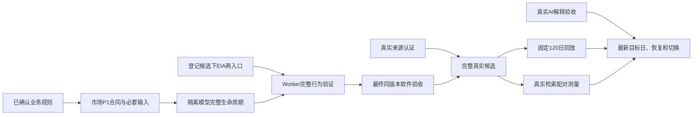

Status: ready-for-agent
Type: implementation-plan-with-interview
Date: 2026-09-12
Scope: 既有数据获取修复规格；重点为任务14、17、19、22及其来源依赖
Round: completed；Q1–Q8全部已确认
Execution boundary: planning-only；用户明确源码修改留给后续 grill me harness 流程

# EIA、注册目录与完整运行的后续规划

本记录承接用户对Claude Code建议的评审以及本次`grill-with-docs`调用。三轮问答已经完成，业务选择以[已确认规则](business-decisions-draft.md)为单一记录；下述计划细化[现有规格](spec.md)和逐票验收。本轮交付文档，不修改应用、执行测试或改变真实模型状态。

## 已确定的目标和边界

- 保留完整交付目标：来源认证、完整真实候选、固定120个中国交易日回放、真实检索测量、报告、恢复与正式切换。
- 先通过公开入口取得可证伪反例，分析根因与影响，再修改生产实现；沿用既有隔离运行目录和测试入口。
- [任务23](issues/23-sqlite-diagnostics-followup.md)的锁诊断增强继续延期，不新增为本期门槛。
- [检查点300](verification-credit-component-300.json)已完成信用脉冲组件切片；[任务19](issues/19-immutable-candidate-catalog.md)已勾选的前三项软件条件继续有效，后续统一验证覆盖其行为。
- 领域词汇沿用[CONTEXT](../../CONTEXT.md)：候选模型版本、生效模型版本、来源认证、公开点时、系统点时和实际模型采用分别表达不同条件。登记目录和软件测试通过均不授予真实来源认证。
- 本次没有形成新的领域术语或架构取舍；工程顺序记在本文件，领域上下文保持术语表用途。

## 事实核对

| 事实 | 当前证据及含义 |
|---|---|
| 四处动态目录查询漏数据库 | [EIA API入库](../../src/pring_cycle/eia_context.py)、[EIA HTML采集](../../src/pring_cycle/eia_html.py)、[Worker](../../src/pring_cycle/worker.py)的官方认证查询和TuShare异常优先级查询。静态问题已确认，尚未取得这四处的新公开RED。 |
| EIA可抢先触发同名错误 | API分支在TuShare上下文和完整缺口检索前执行。有效非空响应进入新目录入库时可抛KeyError，越过局部失败分类，被外层标为action_required；原先保存的采集原件/收据仍可存在。 |
| 两条EIA入口可先行 | API公开采集及HTML CLI接收目录版本，没有active前置。现有完整合成准入可登记候选，EIA维持awaiting_source_certification；其具体正反例仍待实施验证。 |
| 两处Worker都有active前置 | `_execute_run`先检查除报告外的任务模型是否为active，随后才分流定向刷新。因此两处Worker公开验收都需要完整合法的隔离模型生命周期。 |
| 15项市场P1缺注册合同 | [184分派清单](worker-current-contract-boundary-184.json)覆盖六项确认指数、融资、估值、五项广度和两项商品篮子输出。它们含派生结果，应按家族处理输入与计算血缘，不能当成15个直接下载接口。 |
| 旧完整测试已通过 | [212验收](verification-full-suite-acceptance-212.json)记录183默认全套1287通过、5410.54秒，包含原跨期共享预算用例；其后应用已变，不能替代最终版本验收。 |
| 等待策略与锁诊断不同 | [storage](../../src/pring_cycle/storage.py)在迁移及运行时连接设置busy_timeout。完善持锁证据属于延期23；详见[273评审](sqlite-claude-plan-review-273.md)。 |

上述事实是源码和已保存结果的核对，不是本轮运行过应用或测试的声明。

## 实施顺序与完成条件

| 顺序 | 工作与依赖 | 可观察的完成条件 |
|---|---|---|
| M1 | 先做EIA API采集和HTML CLI；复用合法登记候选，不要求active | 同一合法响应在内置目录保持既有行为，新目录反例先失败；修复后可读回候选声明、原件和收据，单位及目录身份正确，未知PUBLIC保持未知。取得失败和解析失败分类保留，不把候选标为真实认证。归入14及19的既有范围。 |
| M2 | 按05–14补注册合同和必要输入；规则相关分支依赖本次问答 | 六项确认指数、融资、估值、广度、商品各有明确输入身份、来源、单位、期次、成员和计算血缘检查；合法正例可通过，错身份、缺成员、坏原件、未来或未知时间按各自规则处理。已完成GDP、UST等支持复用。 |
| M3 | M2所需软件前置具备后构建完整隔离模型生命周期 | 通过公开准入、机器校准、精确日历回放和激活建立隔离active；合成材料始终标明测试用途，真实来源认证和正式运行库状态独立。合法性检查不被替换或跳过。 |
| M4 | 使用M3验证两处Worker漏传，并将M1纳入完整运行 | 官方定向刷新查正确目录并形成可追溯结果；TuShare必需失败保留原异常并阻断，可选失败有记录且按既有规则继续。EIA启用、缺凭据及受控失败分别覆盖；核对实际渠道、原件、任务阶段与结果，避免只凭同名KeyError判定命中。完整运行可读回一致投影及采用集合。 |
| M5 | 必要软件改动完成后统一冻结 | 同一源码、测试、安装包、依赖和输入下完成相关回归、默认全套、前后核验与Standards/Spec审查；包含信用脉冲、Q1、四处调用和原共享预算行为。保存真实终态；实际新失败经定位修复后重跑受影响及最终必需门。 |
| M6 | 沿原来源和产品依赖完成真实交付 | 真实来源认证进入完整候选19；21完成固定120日，20完成同组真实缺口配对测量，18完成真实解释验收；22完成最新目标日、恢复、文档、模型生效及切换。软件全绿只支持软件层结论。 |

当前实施入口为M1。M2业务规则已由问答确定，可按家族推进合同和输入准备；外部证据不足持续记录具体缺件。TuShare反例可显式不配置EIA以隔离路径，EIA本身的完整运行覆盖仍须完成。

公开入口复用位置：EIA API见`tests/integration/test_context_acquisition_receipts.py`，HTML CLI见`tests/integration/test_eia_html_acquisition.py`；登记候选复用`tests/models/test_candidate_admission.py`的公开准入准备。两处Worker既有测试见`tests/integration/test_worker_execution.py`，需要补足真实机器验算的隔离新目录生命周期。以上为只读核对所得入口，不是四处缺陷已经取得RED的声明。

最终全套的执行时机是“无已知必要应用改动待做”，而不是等待所有外部许可或历史原件无限期到齐。后续真实验收引入代码或输入变化时，按规格重新核对受影响的门。

## 决策树与第一轮问题

本轮工程依赖和验证方法由源码事实决定；用户需要决定会改变指标含义的业务选择。以下选择只解除所属业务分支，不授予来源认证。

| 决策 | 第一轮可决定的内容 | 建议 | 状态 | 选择后需要展开的分支 |
|---|---|---|---|---|
| Q1 估值 | 三指数保留静态PE/PB/换手率9成员，还是另加/替换为TTM | 保留原9成员，TTM如新增则独立定义 | 已确认保留原9成员，本期不新增TTM | 无新开放分支，来源和计算定义证据继续按07完成 |
| Q2 日广度 | 保留原沪深北A股及既定五项广度指标，控制实现范围 | 沿用现有目标，特殊事件缺证明确展示，不扩展证券类型或指标 | 已确认“目前定义的范围已经足够”，未选择缩成仅沪深 | Q4/Q5/Q6已在第三轮确认 |
| Q3 商品选约 | 当时已知到期日历选近月，或按持仓量/成交量选主力 | 到期日历法；同合约结算收益沿用既定规则 | 已确认到期日历法 | Q7/Q8已在第二轮确认 |

第一轮已获答复；当时尚待确认的参数已在后两轮收口。当前完整规则见[已确认规则](business-decisions-draft.md)。

第二轮已关闭Q2范围及Q7/Q8，第三轮已关闭Q4–Q6的指标计算细则；已有明确的三核心阶段规则、七袖套与能源20%、固定120日目标、双点时和历史不可变性沿用原决定。

### 第二轮

- Q2：建议保留原沪深北A股和既定五项广度指标，精简本期实现；特殊事件缺证明确展示，依赖完整证据的认证保持未完成。备选为本期仅沪深普通A股，北交所及特殊股票延期；该备选属于需求范围变化，需要同步规格和验收。
- Q7：建议T开始前使用当时已知日历，选择距最后交易日严格超过10个交易所交易日的最近到期合约，T交易时段开始前生效（含夜盘）；T日新公告从下一交易日生效。备选为5日缓冲，其余相同。
- Q8：建议每天恢复固定袖套权重，以2026-03-06收盘1000为基点，2026-03-09起输出既定窗口。备选为仅换约时恢复固定权重，基日相同。两者均要求基日与历史输入认证。

第二轮实际答复已记录在下方。Q2保留原范围，Q7采用10日缓冲及所述生效边界，Q8采用每日恢复固定权重及上述基日1000。

### 第三轮

- Q4：建议共同最近120个市场交易日含当日；不足完整历史者退出窗口指标分母；历史停牌只延续已认证价格，未知缺价不填，目标日全天停牌不参与；使用当时可知复权事件。高于MA严格大于，新高/低等于窗口极值且至少有两个不同价格。备选为另加短窗口指标。
- Q5：建议保留普通竞价、适用盘后固定价格和大宗交易等全范围金额，分子分母同口径；不适用单列，适用但缺数保持未知，必需金额不全时指标不可用。备选为明确将本期口径缩为普通竞价。
- Q6：建议保留现有`adv/max(dec,1)`及零下跌标记，零参与输出不可用，平盘独立计数。备选为零下跌时仅展示家数、不输出比值。

第三轮用户确认全部推荐规则；当前决策树没有尚待回答的业务分支。后续发现的新来源事实按认证要求处理，不重新询问已经明确的选择。

## 文档落点与后续执行

1. 实际答复保存在本文件，当前口径集中于`business-decisions-draft.md`；路径保留以兼容旧引用。相关任务引用规则和本计划，历史评论继续作为历史事实保留。
2. 已完成的规划决定与未完成的软件/认证分别记录。没有新领域词汇或新架构决策，因此本轮不改CONTEXT或新增ADR；本版本指标参数写入后续不可变定义。
3. 用户明确源码修改留给后续 grill me harness 流程；本轮只完成问答和文档，ready-for-agent表示规划可交接，不表示本会话开始实施。后续实施从M1开始，沿用原任务和公开入口；每段先RED、根因和影响，再修复与验证。M5及M6分别支持软件完成和真实产品完成，旧通过数保持原版本边界。

## 答复记录

### 第一轮用户答复

> ❓ Q2 — 股票广度的统计范围：暂不扩展过多
> 其余确认

记录为Q1保留原三指数×静态PE/PB/换手率9成员、Q3采用到期日历法已确认。Q2确认了控制范围的偏好，但没有明确删除北交所、ST、退市整理或既定指标；本轮不据此改写这些定义。10日缓冲、权重恢复时点与基点此前未在第一轮提问，留到第二轮确认。

### 第二轮用户答复

> ❓ Q2 追问 — “广度暂不扩展过多”具体采用哪种边界？目前定义的范围已经足够
> 其余确认

记录为保留原股票池目标和既定五项广度指标，控制范围、精简实现；不缩减为仅沪深，也不新增证券类型/指标。Q7采用严格超过10个交易所交易日的选约缓冲，T交易时段开始前生效（含夜盘），当日新公告影响下一交易日；Q8采用每日恢复固定权重、2026-03-06收盘1000基点与既定120日窗口。上述参数已确认，但真实来源/历史时点认证仍待完成。

### 第三轮用户答复

> 确认

Q4确认完整120日窗口及参与/复权/极值规则；Q5确认全范围金额及缺数不可用；Q6确认现有涨跌比公式、零下跌标记、零参与不可用。三轮问答完成，业务规则可进入后续实现；本轮没有执行应用、测试、来源认证、模型激活或切换。
